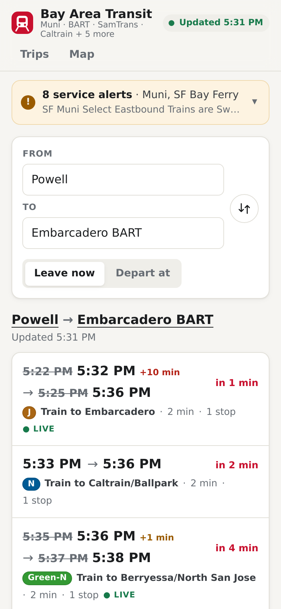
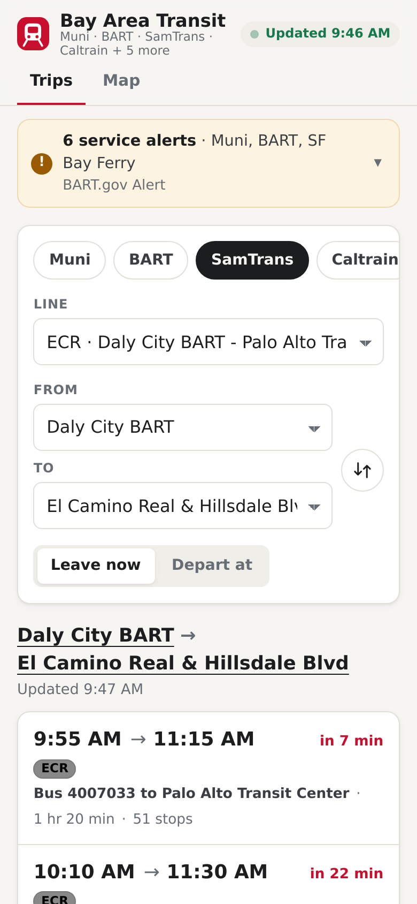
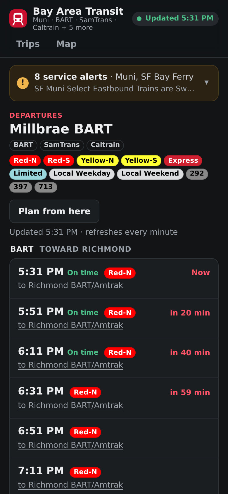
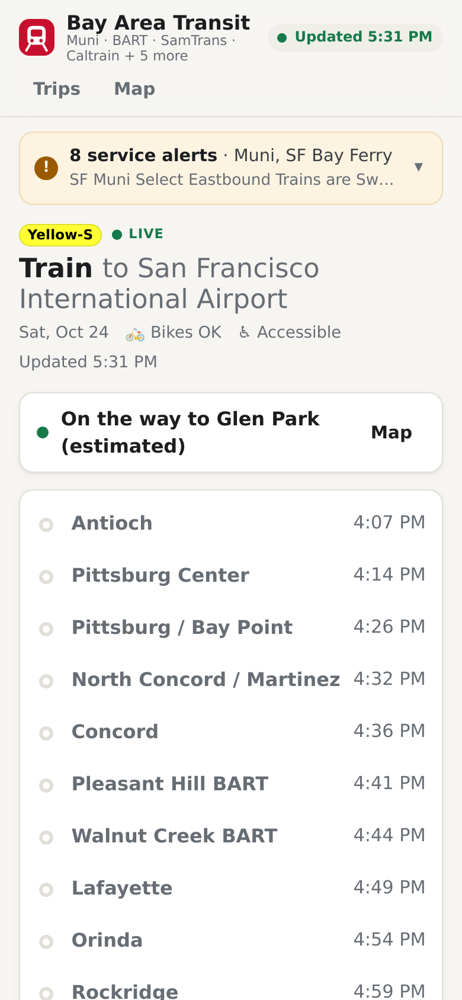
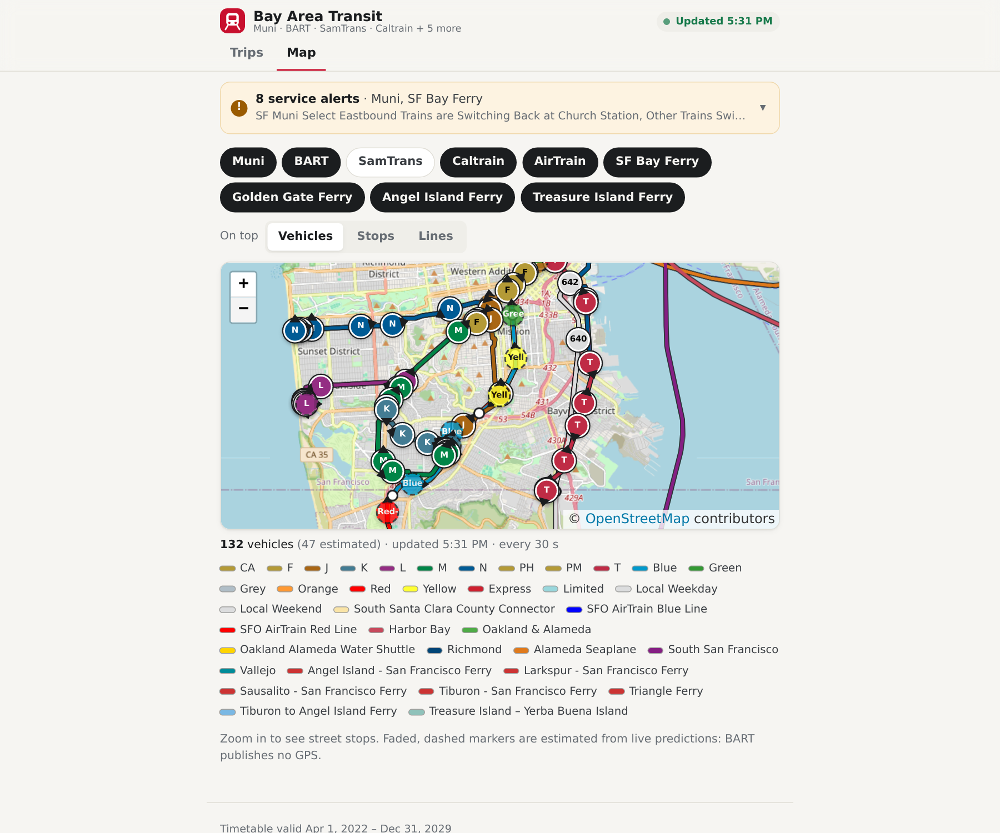

# bay-area-transit

Bay Area transit schedules with live predictions, built on the
[511.org open data](https://511.org/open-data/transit) regional GTFS and
GTFS-realtime feeds: Muni Metro and cable cars, BART, SamTrans, Caltrain,
SFO AirTrain, SF Bay Ferry, Golden Gate Ferry, and the Angel Island and
Treasure Island ferries.

<table>
  <tr>
    <td width="25%"></td>
    <td width="25%"></td>
    <td width="25%"></td>
    <td width="25%"></td>
  </tr>
  <tr>
    <td>Plan a trip on one agency</td>
    <td>Big agencies: a line, then its stops</td>
    <td>Departure boards</td>
    <td>Trip detail</td>
  </tr>
</table>



## What it does

- **Plan** direct trips on one agency at a time, with live departure and
  arrival times, delays and cancellations. Pick the agency, then its
  stations from two dropdowns, in line order. Muni and SamTrans have too
  many stops for one list, so you pick a line first. A journey that needs a
  transfer, or runs only on other days, says so.
- **Departure boards** for any place, grouped by agency and direction:
  Northbound/Southbound, Inbound/Outbound, or toward the main destinations.
- **Trip detail** with every stop's scheduled and predicted times, and
  where the vehicle is now.
- **Map** of lines, stations and live vehicles, with a toggle per agency
  and a switch for what's on top (vehicles, stops or lines) so anything can
  be tapped. Pick a line in the legend to fade everything else. Agencies
  that publish no GPS (BART) get positions estimated from their live
  predictions, drawn faded. On large screens the map fills the window,
  with the controls floating over it.
- **Service alerts**, collapsed into one bar when there are several,
  labeled with the agencies they affect.
- Works on phones and large screens, in light and dark mode.

## How it's built

- **backend/**: Django 5.2 + PostGIS. Imports static GTFS feeds into a
  constrained schema, polls GTFS-realtime, and serves a read-only JSON API
  ([docs/api.md](docs/api.md)): trip planning, departure boards, trip
  detail, live vehicles and alerts.
- **frontend/**: Angular 22, zoneless, signals throughout. Trip planner
  (an NgRx SignalStore), departure boards, trip detail and a Leaflet map
  with per-agency layers and live vehicles. Polled reads are `httpResource`s
  that keep their last good value through a failed refresh.
- **docker-compose.yml**: `db` (PostGIS), `backend` (gunicorn), `worker`
  (feed refresh and realtime poller) and `web` (nginx serving the built
  frontend and proxying `/api`).

## Setup

```sh
./scripts/bootstrap.sh     # writes .env and secrets/, once
```

It needs a 511 API key ([request one](https://511.org/open-data/token)) in
`secrets/transit_511_api_key`. If the old `secrets/api.cfg` is there, the key
is copied from it.

## Run it

```sh
(cd frontend && npm ci && npm run build)
docker compose up -d --build
open http://127.0.0.1:8086
```

On first start the worker downloads 511's regional feed (about 60 MB) and
imports the selected agencies (about a minute), then starts polling realtime.
`?op=CT` on any URL shows a single agency's own feed instead, if
`TRANSIT_OPERATORS` imports it.

## Develop

```sh
# Backend with autoreload on 127.0.0.1:8087
docker compose -f docker-compose.yml -f docker-compose.dev.yml up -d db backend worker

# Frontend dev server, proxying /api to 8087
devrun up --name web --port-env PORT -- "$PWD/frontend/scripts/dev.sh"
devrun url web
```

Tests:

```sh
DC="docker compose -f docker-compose.yml -f docker-compose.dev.yml"
$DC run --rm backend python -m pytest      # backend, against a throwaway PostGIS db
$DC run --rm backend ruff check .
(cd frontend && npm test && npm run typecheck)
```

Useful management commands (`$DC exec backend python manage.py ...`):

| Command | Does |
|---|---|
| `fetch_feeds [RG]` | Download static feeds from 511, import any that changed |
| `import_gtfs path.zip --operator CT` | Import a local archive or folder |
| `poll_realtime [RG] [--kind alerts]` | Poll realtime once |
| `run_worker` | What the `worker` service runs |
| `createsuperuser` | For `/admin/` (read-only browsing), at http://127.0.0.1:8087/admin/ only: the `web` container deliberately doesn't proxy it |

## 511 rate limit

511 allows **60 requests/hour per API key**, shared by everything that
uses the key. At the default intervals, realtime for one operator costs 46
requests/hour (trip updates and vehicle positions every 3 minutes, alerts
every 10), and the worker refuses to start with a schedule over
`TRANSIT_511_HOURLY_BUDGET` (55). That's why realtime is on for one
operator at a time. Static feeds are checked once a day and only re-imported
when the archive changes.

`RG` is 511's regional feed: one static archive and one realtime request per
kind cover every agency. `TRANSIT_RG_AGENCIES` picks what gets imported: a
comma-separated list of agency ids, each optionally limited to GTFS route
types. The default, `SF:0+5,BA,SM,CT,SI:0,SB,GF,AF,TF`, is Muni light rail
and cable cars (no buses), BART, SamTrans, Caltrain, the AirTrain (not SFO's
shuttle buses) and the four ferry operators. The poller drops realtime about
anything the import left out, so realtime for all of them costs the same 46
requests/hour as one agency. 511's operator list has about 40 more, from AC
Transit to SMART; adding one is a matter of listing its id.

## Data model

Every GTFS table carries its `feed`. GTFS ids are unique per feed, and
enums and conditional requirements are check constraints. Times are
seconds after the start of the service day, so 25:10:00 works. The importer
runs in one transaction and rejects a feed whole, listing every problem by
file and line. Untimed stops are interpolated, and a new feed becomes active
only once it is complete. Realtime is stored as replaceable snapshots keyed
by GTFS ids, never foreign keys, so a feed swap can't break it. See the
docstrings in `backend/transit/models/`.

**Places** are derived at import, not read from GTFS: a station with its
platforms, or same-named stops within 300 m (both sides of a street). They
are what riders search for (`places?q=`, trigram-matched), plan between and
see boards for, so picking the wrong side of the street still finds trips.

Vehicles without GPS are **estimated** from their trip's predicted stop
times: at the platform between predicted arrival and departure, else along
the route's shape in proportion to the time elapsed between stops.
`/vehicles` marks each one `"source": "gps"` or `"estimated"`.

Not modelled yet: fares from the regional feed (it uses GTFS Fares v2),
frequencies.txt, transfers.txt, and journeys that need a transfer (Powell
to Hillsdale changes from BART to Caltrain at Millbrae).
